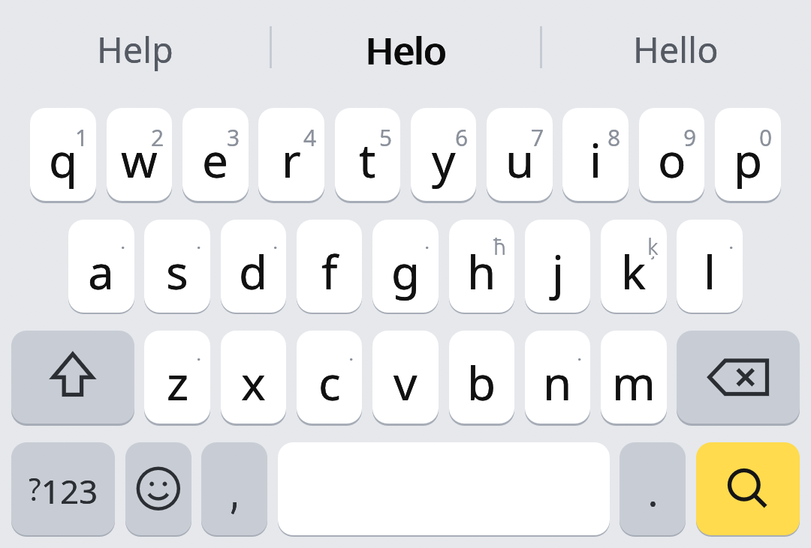
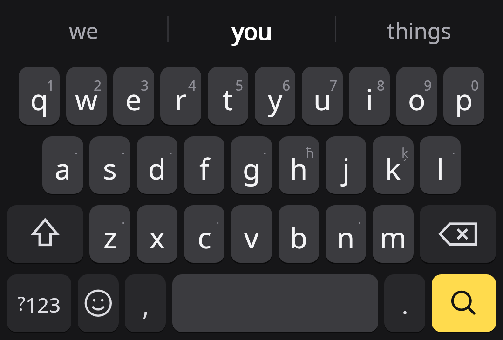
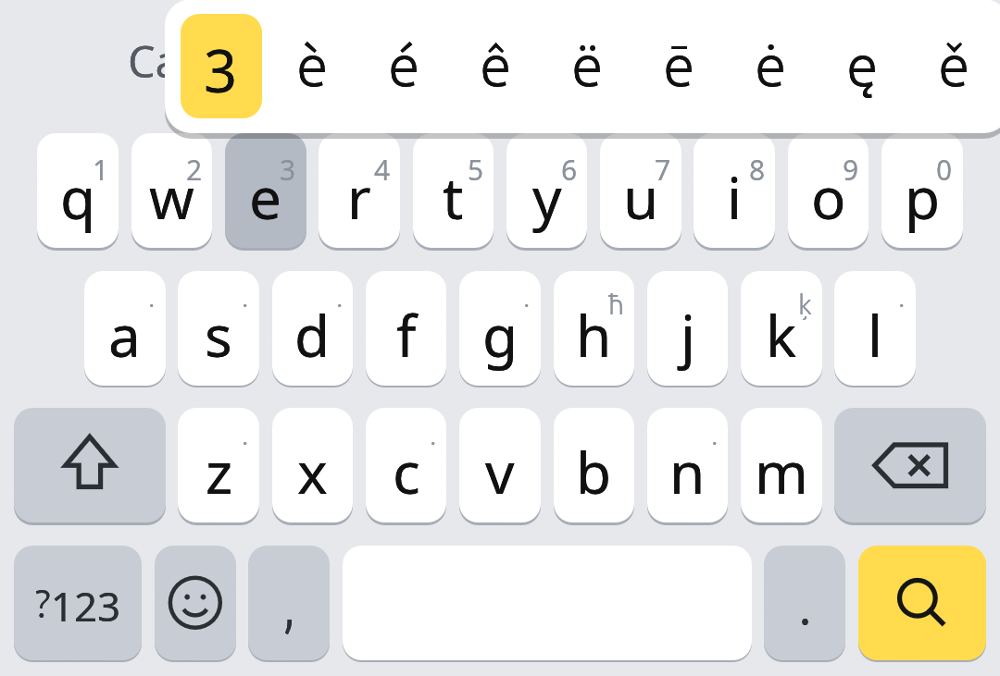

<div align="center">

# ⌨️ Rynk

**A fast, private Android keyboard with smart autocorrect for 117 languages.**

Written in Rust · drawn with egui on Vulkan · nothing ever leaves your phone

[](LICENSE)
[](https://github.com/Kolya62/Rynk/releases/latest)






<sub>Fixing a typo · predicting the next word in the dark theme · long-press accents</sub>

**[⬇️ Download the latest APK](https://github.com/Kolya62/Rynk/releases/latest)**

</div>

## ✨ Why Rynk

- 🎯 **Autocorrect that understands your fingers.** A touch model learns where *you* actually hit each key.
- ✍️ **Swipe typing.** Slide across the letters of a word without lifting your finger.
- 🔮 **Predictions** of the next word as soon as you press space.
- 🌍 **117 layouts**, including Chinese, Japanese, Korean, Arabic and Indic scripts.
- 🔒 **Fully offline.** No network permission, no accounts, no telemetry.
- 🌗 **Light and dark themes** that follow the system.
- 🦀 **Rust core.** The whole interface is drawn on the GPU through Vulkan.

License: GPL-3.0-or-later. Dictionaries and language models: CC BY-SA 4.0, see
[DATA_LICENSES.md](DATA_LICENSES.md).

## 📋 Features

- **117 layouts.** Latin, Cyrillic, Greek, Armenian, Georgian, Hebrew, Arabic script, Indic
  scripts (InScript with a Shift layer), Sinhala, Thai, Lao, Khmer, Myanmar, Ethiopic, Korean.
- **Chinese.** Pinyin with simplified or traditional characters, Zhuyin (bopomofo) for Taiwan and
  Jyutping for Cantonese. Whole phrases convert at once ("zhongguoren" → 中国人); a shorter
  candidate keeps the rest of the input.
- **Japanese.** Romaji → kana → kanji, including inflected verbs and adjectives (たべた → 食べた).
  Space walks through candidates, Enter confirms.
- **Vietnamese Telex** (aa → â, ow → ơ, dd → đ, tones s f r x j).
- **Swipe typing.** The drawn path is compared with each word's path through its key centers
  and weighed by the language model; the strip offers alternatives, and Backspace removes a
  swiped word at once.
- **Default languages** are the system languages that have a layout, plus English. A swipe on the
  space bar switches to the next or previous one (a long press then moves the cursor); both
  swipe features can be turned off.
- **Typing aids.** Word suggestions and next-word predictions, double-space period, smart spacing
  around punctuation, auto-capitalization, cursor control on the space bar, word deletion
  by swiping Backspace, accelerating Backspace repeat, long-press variants with a corner hint
  ("ъ" on "ь", "ё" on "е"), color emoji, light and dark themes, landscape and tablet layouts.
- **Complex scripts in the strip.** Arabic letters are joined, right-to-left text is reordered and
  Indic pre-base vowel signs are placed correctly, since egui has no shaping engine.

## 🧠 Autocorrect

A noisy-channel model:

```
P(word | touches, context) ∝ P(touches | word) · P(word | context)
```

1. **Touch model.** Each key is a 2D Gaussian around its center. Centers adapt to the user from
   the words they accept.
2. **Dynamic key grid.** The letter of a touch is chosen from geometry times the probability of
   the next letter in the dictionary. A key's hit area grows by at most 50%, and the grid is
   static right after Backspace.
3. **Candidate search.** A trie walk that prices every touch and allows an extra touch, a missed
   letter and swapped neighbours (doubled letters cost less).
4. **Language model.** Corpus trigrams and bigrams with stupid backoff, merged with the user's own
   words and word pairs.
5. **Decision.** A word is replaced on space or punctuation. A word the dictionary knows is only
   replaced by a much more likely one. Backspace right after a replacement restores the typed word
   and stops correcting it.

## 🛠️ Building

Requires Rust with the `aarch64-linux-android`, `armv7-linux-androideabi` and
`x86_64-linux-android` targets, [cargo-ndk](https://github.com/bbqsrc/cargo-ndk), Android SDK 35
and NDK 26.3.11579264.

```bash
./gradlew assembleRelease
```

Gradle builds the Rust core for arm64-v8a, armeabi-v7a and x86_64. The release build shrinks code
and resources and compresses native libraries and dictionaries. Signing keys come from
`local.properties` or environment variables (see `local.properties.example`); without them the
APK is unsigned.

```bash
cargo test --release -p rynk_core
cargo run --release -p rynk_core --example snapshot -- /tmp/shots
```

The tests check autocorrect on the real Russian model, conversion for Chinese, Cantonese and
Japanese, every layout and model, and typing scenarios end to end. `snapshot` renders the keyboard
offscreen with Vulkan to PNG files, no phone needed.

Generators: `tools/gen_layouts.py` (layouts), `tools/lmgen.py` (word models),
`tools/cjkgen.py` (Chinese and Japanese dictionaries). `tools/rlm2.py` packs word models into
the denser RLM2 format, and the assets are then compressed with `zstd -19`.

## 🗂️ Layout of the code

| Path | Contents |
|---|---|
| `rust-core/src/engine` | language model, trie, touch model, decoder, CJK conversion, personal dictionary |
| `rust-core/src/compose` | Hangul, kana, zhuyin and Telex composers |
| `rust-core/src/layout` | languages and key geometry |
| `rust-core/src/keyboard.rs` | keyboard state: touches in, editor commands out |
| `rust-core/src/ui` | keyboard painting and the settings screen in egui |
| `rust-core/src/gfx.rs`, `android.rs` | Vulkan through wgpu, JNI |
| `app/src/main/kotlin` | input method service, Surface, InputConnection |

## ⚠️ Known limitations

- Scottish Gaelic and Lao have no word model; Kurmanji, Thai, Khmer and Myanmar only a short list.
- Japanese conversion works on words and stems, without a full morphological analyzer.
- egui does not form Indic conjuncts; in the editor the app renders text itself.
